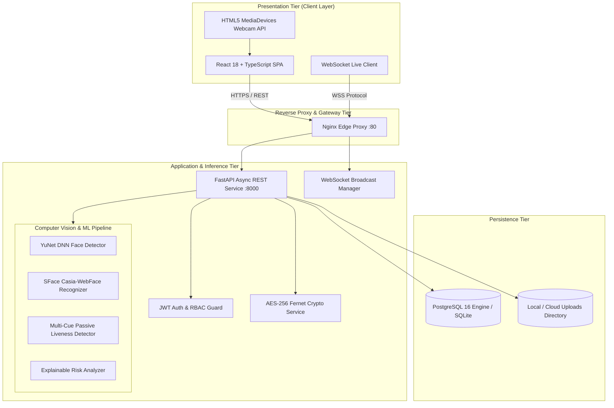
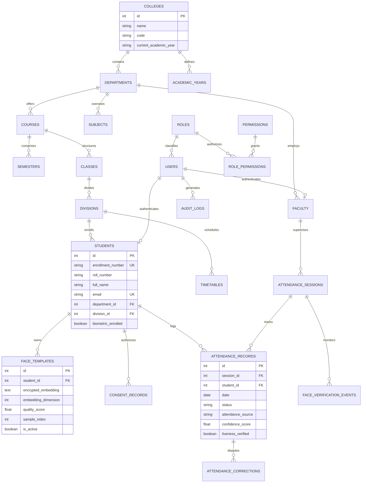
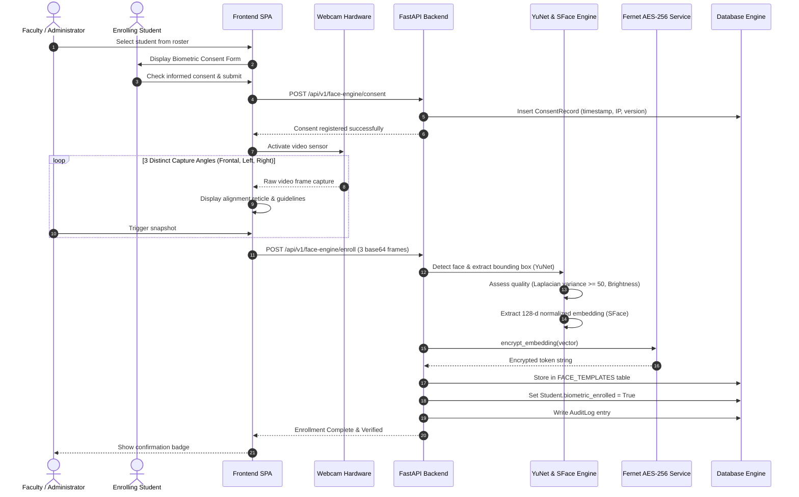
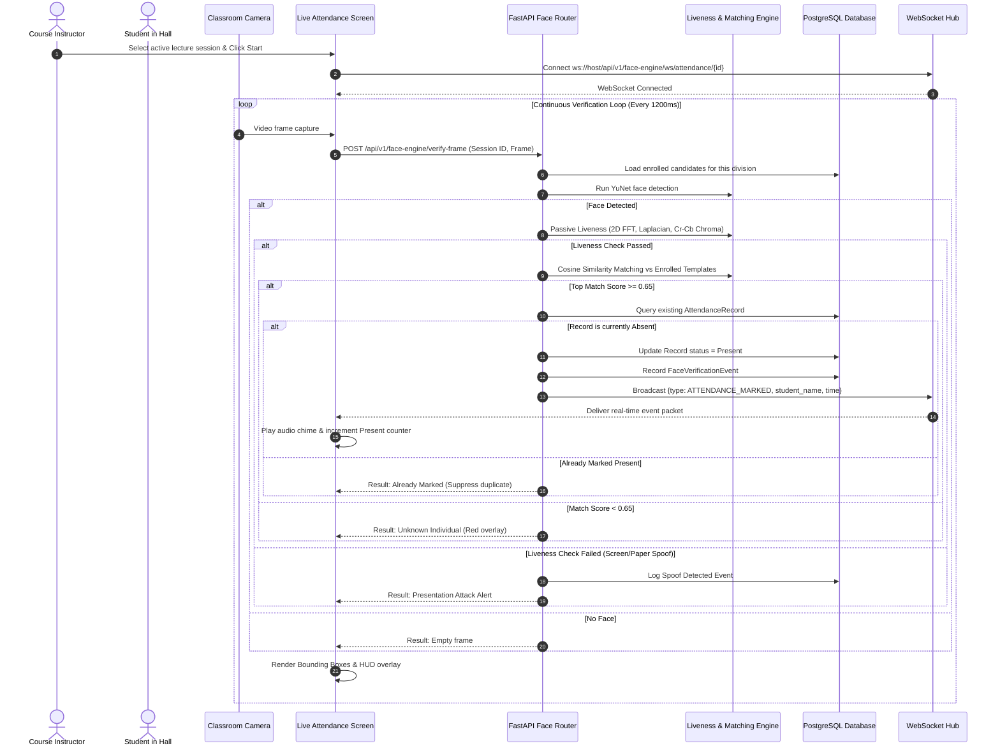

# AttendX AI – Technical Architecture & UML Specifications

## 1. High-Level System Architecture

---

## 2. Entity-Relationship Diagram (ERD)

---

## 3. Sequence Diagram: Biometric Face Registration Workflow

---

## 4. Sequence Diagram: Live Face Attendance & WebSocket Broadcast

